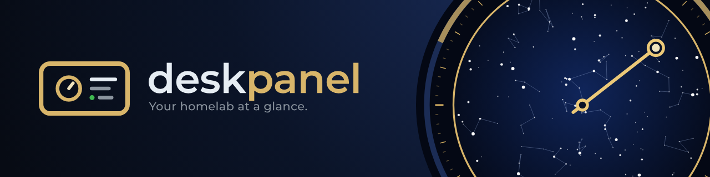
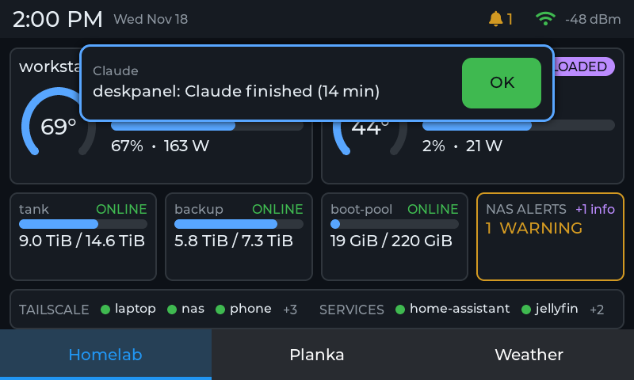
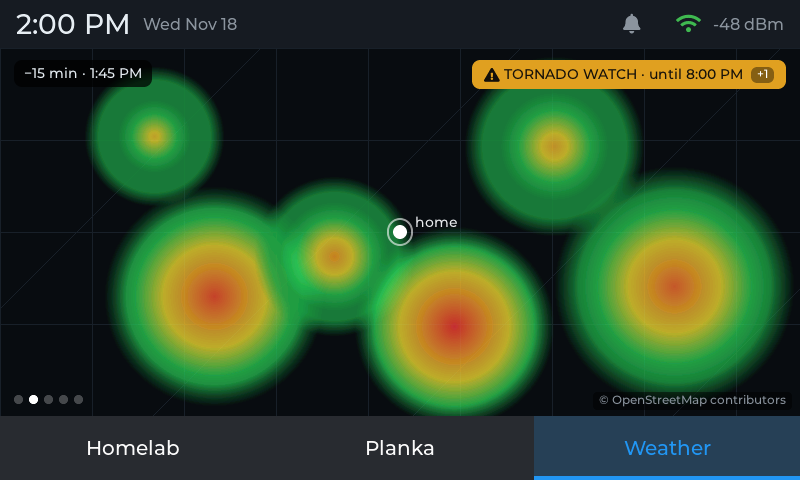
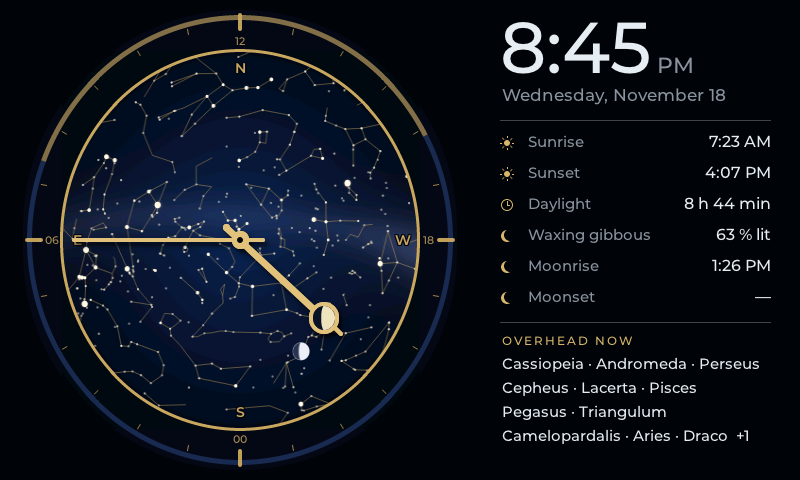
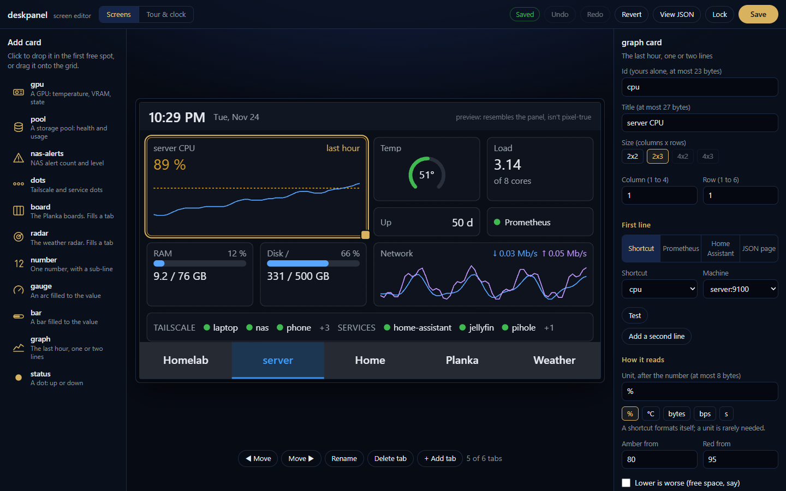
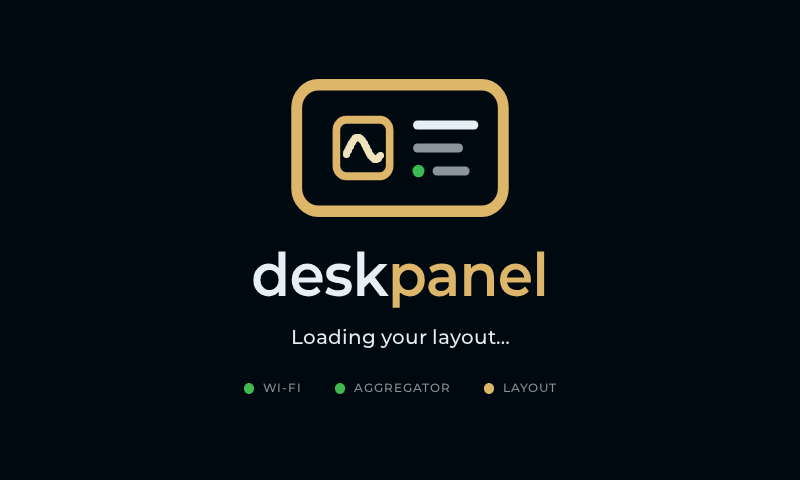
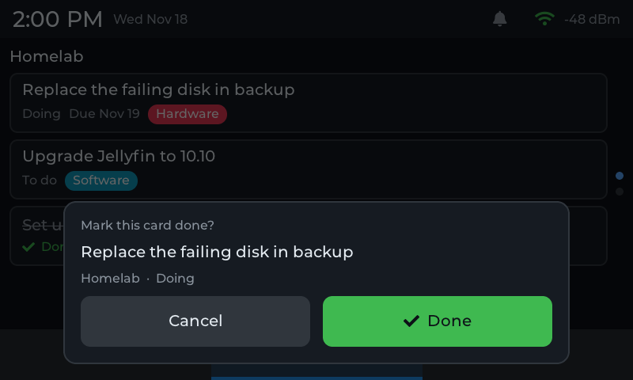

<picture><source media="(prefers-color-scheme: light)" srcset="docs/img/banner-light.png"></picture>

**An always-on status screen for your homelab, sitting beside your keyboard.** Your Grafana dashboards live in
a browser tab you never have open. deskpanel puts the handful of things you actually glance at on a 4.3″ ESP32
touchscreen, and pops up a notification when something wants you. It is for people who already run a homelab
and would rather look at a screen than open a tab.



| A notification pops up | Weather radar loop | Astronomical clock |
|---|---|---|
|  |  |  |
| **Lay it out in your browser** | **Startup** | **Tap a card to finish it** |
|  |  |  |

The panel screenshots come from the [PC simulator](firmware/README.md#pc-simulator): the panel's real UI code,
rendering the aggregator's demo data. More of them are in [docs/screen.md](docs/screen.md).

## What you get

- **Glanceable, not another tab.** One screen and a few tabs, readable from across the desk. An amber
  frame or a red dot is the whole story.
- **Your homelab on it.** GPU load and temperature, pool health and NAS alerts, which services and tailnet
  devices are up, and the task cards you're working on.
- **A weather radar** loop with the current conditions and National Weather Service alerts (US only). A
  tornado warning for your spot takes over the screen.
- **An astronomical clock**: the real sky over your spot, the sun and the moon, on a 24-hour dial.
- **Speaks what you already run.** Notifications from Alertmanager and Grafana webhooks and ntfy-compatible
  publishing, so Uptime Kuma, scripts and CI can point at it unchanged. Data from TrueNAS, `nvidia-smi`,
  Tailscale, HTTP health checks and Planka, plus cards for any Prometheus number, an app's JSON status page or
  a Home Assistant entity. Each source is optional.
- **Claude Code hooks included.** One installer adds three hooks: the panel tells you when Claude needs
  you, and when a turn longer than 2 minutes finishes. Handy when a full-screen game hides your taskbar.
- **Taps do things.** Mark a task card done from the panel. Tap the NAS alerts tile for the details. Tap
  the bell for the notification history.
- **Never blank.** If the server goes away, the last data stays on screen, greyed out with a STALE pill.
  It even survives a panel reboot (kept on the SD card).
- **Keys stay on the server.** The panel holds one read token. A small Go aggregator on your server makes
  every API call and holds every credential. LAN only, bearer auth.
- **Lay it out in your browser.** An optional screen editor on the aggregator moves cards around, picks their
  data from your own GPUs, pools, Prometheus and Home Assistant, and saves `layout.json` for you.
  [Try it on made-up data.](https://zebadrabbit.github.io/deskpanel/editor/)
- **Try it without a homelab.** `DEMO=1` fills it with lively fake data.
- **Shows itself off when you're away.** Leave it alone for 5 minutes and it tours its tabs and comes home to
  the clock, so nothing sits on screen all day long to burn in. Your first touch only stops the tour.

## What you need

- The Waveshare **ESP32-S3-Touch-LCD-4.3B** (the **B** variant) and a USB-C cable. About $55, sold by
  Waveshare and on Amazon and AliExpress: [what to buy, and other boards](docs/hardware.md).
- A microSD card, FAT32.
- A Linux machine with Docker (amd64 or arm64) for the aggregator, and a 2.4 GHz Wi-Fi network from which the
  panel can reach it.
- Chrome or Edge, to flash the panel.
- Optional: TrueNAS SCALE 25.04+, NVIDIA GPUs, Tailscale, Planka 2.x, Prometheus, Home Assistant, Claude Code.
  Leave a source's URL empty and it is skipped.

## Install

Nothing to compile.

1. **Flash the panel from your browser.** Open the [flasher page](https://zebadrabbit.github.io/deskpanel/),
   plug the panel in over USB-C and click **Connect & flash**.
2. **Make its `settings.txt`** on the same page: Wi-Fi, server address, token, time zone. The file is made in
   your browser; nothing is sent anywhere. Copy it to the top folder of the microSD card, put the card in the
   panel and restart it.
3. **Start the aggregator** from the prebuilt image:
   ```sh
   git clone https://github.com/zebadrabbit/deskpanel && cd deskpanel/aggregator
   cp .env.example .env    # PANEL_TOKEN (the one in settings.txt), LISTEN, TZ, then the sources you have
   docker compose -f compose.image.yaml up -d
   ```

**Just trying it?** No homelab needed, fake data:
`docker run -d --name deskpanel -p 8088:8088 -e DEMO=1 -e PANEL_TOKEN=<token> ghcr.io/zebadrabbit/deskpanel-aggregator`

The full version, first boot, and building the firmware and the image yourself:
[docs/getting-started.md](docs/getting-started.md).

## How it works

The ESP32 is a thin client: it renders the UI and sends touch actions, nothing else. A small Go aggregator on
your home server makes every API call, holds every credential and shapes the data into one compact JSON
document the panel polls.

```
TrueNAS  (JSON-RPC over wss)  ─┐
GPU agents (nvidia-smi)        ─┤
Tailscale (LocalAPI)           ─┤                    GET  /api/v1/panel            (ETag, ≤ 8 KB)
Services (HTTP /health)        ─┼─> aggregator (Go) ─────────────────────────────────> ESP32-S3 4.3B
Planka   (REST)                ─┤   on your server  <─────────────────────────────────
Notifications                  ─┘                    POST .../cards/{id}/done, .../notify/{id}/read
   ↑ Claude Code hooks, Alertmanager/Grafana webhooks, ntfy publishers (Uptime Kuma, scripts, CI),
     curl, and the aggregator's own events
```

## Using it day to day

`<server-ip>` is the aggregator's LAN address, `<repo>` your checkout.

- **Move cards or add a tab:** open `http://<server-ip>:8088/editor/` ([editor](docs/editor.md)), or edit
  `aggregator/config/layout.json` by hand ([layout](docs/layout.md)). The panel follows in about 20 s.
- **Point a card at Prometheus, a JSON page or Home Assistant**, and read a card's small text: [cards](docs/cards.md).
- **Show a Planka board:** add the `deskpanel` user to it as an Editor ([how-to](docs/how-to.md#show-a-planka-board-on-the-panel)).
- **Add a service dot:** `SERVICES=jellyfin=http://<nas-ip>:8096/health,…` in `aggregator/.env`, then
  `docker compose up -d --force-recreate` ([how-to](docs/how-to.md#add-a-service-dot)).
- **Send a message to the panel**, or hook up Uptime Kuma, Grafana, Alertmanager or Claude Code:
  [how-to](docs/how-to.md#put-my-own-message-on-the-panel).
- **Open the clock:** tap the time. Tap anywhere to close it ([screen](docs/screen.md#idle-tour-and-astronomical-clock)).
- **Change Wi-Fi, server address or token:** edit `settings.txt` on the SD card and restart the panel
  ([settings.txt](docs/getting-started.md#settingstxt)).
- **Update:** `docker compose -f compose.image.yaml pull && docker compose -f compose.image.yaml up -d` for the
  aggregator; flash again from the flasher page for the panel ([how-to](docs/how-to.md#update-the-aggregator)).
- **STALE in the status bar, or anything else odd:** `cd <repo>/aggregator && docker compose ps && docker compose logs --tail 30`,
  then [troubleshooting](docs/troubleshooting.md).

## Documentation

| Page | What's in it |
|------|--------------|
| [The hardware](docs/hardware.md) | What to buy and where, what else you need, why this exact board, what a port to another board takes. |
| [Getting started](docs/getting-started.md) | Both install paths, first boot and the startup screen, `settings.txt`, the `.env` essentials. |
| [What's on the screen](docs/screen.md) | Every tile, colour and badge. Notifications, the idle tour, the astronomical clock, the weather. |
| [layout.json](docs/layout.md) | Your own tabs by hand: the grid, card types and sizes, taps, limits, the `tour` block. |
| [Cards](docs/cards.md) | Prometheus, JSON and Home Assistant cards, GPU card slots, what a card's small text means. |
| [The screen editor](docs/editor.md) | Laying out tabs in the browser: `EDITOR_TOKEN`, saving, the backup file, the demo. |
| [How do I…](docs/how-to.md) | Planka boards, notifications from other tools, Claude Code hooks, GPU machines, updates, tokens. |
| [Troubleshooting](docs/troubleshooting.md) | "When something looks wrong", and where everything lives. |
| [Index](docs/README.md) | All of the above, plus what's in each folder of the repository. |

Internals (API, every config variable, build, simulator): [aggregator/README.md](aggregator/README.md) and
[firmware/README.md](firmware/README.md).

## Status

It runs every day on its author's desk. Working today:

- **Homelab page:** GPU tiles, pool and NAS alert tiles, Tailscale and service dots, stale handling.
- **Planka page:** your boards' cards, with mark-done from the panel (it rolls back if the server says no).
- **Weather page:** NEXRAD radar loop, conditions, NWS alerts and the tornado-warning takeover (US only).
- **Your own tabs:** `layout.json` and the browser screen editor; cards for Prometheus, JSON status pages and
  Home Assistant.
- **Notifications** with history, from Alertmanager and Grafana webhooks, ntfy publishers, Claude Code hooks and
  the aggregator's own events.
- **Idle tour and astronomical clock**, a startup screen, and the last data kept on the SD card across reboots.
- **Self-restart** if the panel hangs, with the reason noted in the bell.
- **For trying and developing:** demo mode, a browser flasher with a prebuilt firmware, a prebuilt aggregator
  image, and a PC simulator that makes the screenshots.

Tested on one board, the Waveshare 4.3B below. Weather alerts are US only.

## Hardware

Waveshare ESP32-S3-Touch-LCD-4.3B: ESP32-S3-WROOM-1-N16R8 (16 MB flash, 8 MB PSRAM), 800×480 RGB IPS,
GT911 capacitive touch, CH422G IO expander (backlight on/off, touch reset, SD CS), PCF85063A RTC,
microSD slot. Where to get it and what the firmware relies on: [docs/hardware.md](docs/hardware.md).

## Secrets

Nothing secret is committed. The aggregator reads `aggregator/.env` (template `aggregator/.env.example`); the
firmware reads `firmware/main/secrets.h` (template `firmware/main/secrets.example.h`). Both are gitignored. And,
if you use one, `settings.txt` on the panel's SD card (plain text). The flasher page's firmware has nothing built
in: it is built from `secrets.example.h`, never `secrets.h` ([firmware/README.md](firmware/README.md#release-build-the-flasher-pages-firmware)).

## License

[MIT](LICENSE). Bundled third-party material: the Montserrat font in `firmware/main/fonts/` is under
the SIL Open Font License 1.1 ([OFL.txt](firmware/main/fonts/OFL.txt)). The astronomical clock's star
positions and constellation figures in `aggregator/skydata/` are trimmed from
[d3-celestial](https://github.com/ofrohn/d3-celestial) by Olaf Frohn (BSD 3-Clause,
[LICENSE](aggregator/skydata/LICENSE)); its stars come from the Hipparcos-based XHIP catalogue and its figures and
names from the IAU's. Fetched at build time and under their own licenses: LVGL (MIT), Espressif's
`esp_lvgl_port` and `esp_lcd_touch_gt911` (Apache-2.0), ESP-IDF (Apache-2.0), coder/websocket (ISC).

Pin assignments and panel timings come from Waveshare's published 4.3B demo and schematic. Weather data credits
(Iowa Environmental Mesonet, OpenStreetMap, the National Weather Service, Open-Meteo) are in
[docs/screen.md](docs/screen.md#weather-credits).

---

Built by Panda (Erin Lukens) with AI assistance from Claude.
