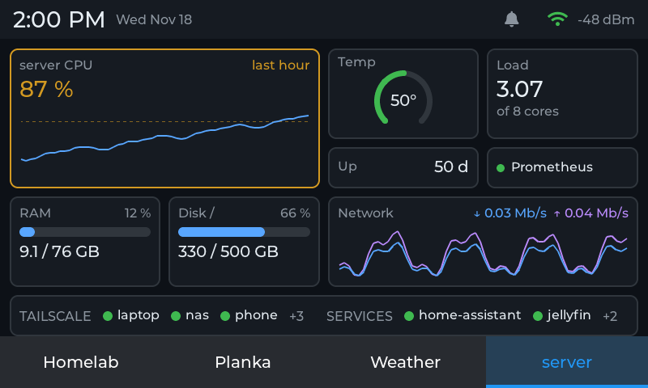
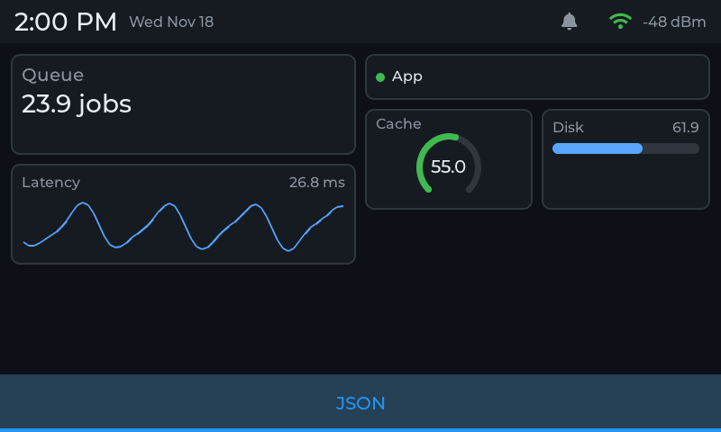
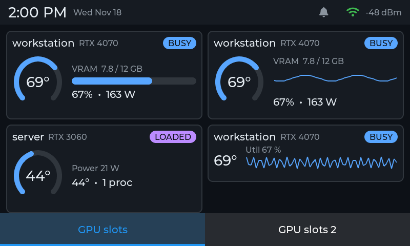

# Cards

`<server-ip>`, `<repo>`, **the server** and **the PC** mean the same on every page: see [Words used in these pages](README.md#words-used-in-these-pages). [Back to the index](README.md).

A card is one tile on a tab. Where cards go, their sizes and taps are in [layout.json](layout.md); this page
is what a card can show.

- [General cards: any Prometheus number](#general-cards-any-prometheus-number)
- [General cards: a number or word from an app's JSON status page](#general-cards-a-number-or-word-from-an-apps-json-status-page)
- [General cards: Home Assistant](#general-cards-home-assistant)
- [GPU cards: choose what they show](#gpu-cards-choose-what-they-show)

**What a card's small text means.** A card that can't show its value says why in small text under a "—".
Each source has its own table: [Prometheus](#general-cards-any-prometheus-number) ("When a card can't show a
number"), [JSON](#general-cards-a-number-or-word-from-an-apps-json-status-page) and
[Home Assistant](#general-cards-home-assistant) ("When the card can't show it"). `no gpu 'X'` and `no pool 'X'`
are in [layout.json](layout.md#what-happens-when-you-save).

## General cards: any Prometheus number

Five card types show a number from Prometheus: `number`, `gauge`, `bar`, `graph` and `status`. Point the
aggregator at your Prometheus by adding this to `aggregator/.env` (no password; it is read-only queries):

```sh
PROMETHEUS_URL=http://<prometheus-host>:9090
```

then recreate the container (`docker compose up -d --force-recreate`). Without it, a card that needs
Prometheus shows "—" and `set PROMETHEUS_URL`. Prometheus is asked for each number every 30 s and for each
graph's last hour every 60 s, so a card can lag by up to a minute; the aggregator answers the panel from
what it already has, so a slow Prometheus never freezes the screen.



A tab like that one is in `aggregator/layout.example.json` (named `server`): copy it into your own
`layout.json`. One card looks like this:

```json
{"id": "cpu", "type": "graph", "at": [1, 1], "size": "2x3", "title": "server CPU", "value": "cpu",
 "unit": "%", "warn": 80, "bad": 95}
```

**`value`** is required, in one of five forms:
- **A shortcut**, a word such as `"cpu"` or `"disk:/"` (table below). Needs the standard `node_exporter` metrics.
- **Your own query**: `{"prometheus": "up{job=\"jellyfin\"}"}`, any PromQL up to 512 bytes. It must return
  **one** number.
- **An app's JSON status page**: `{"json": {"url": "http://app.lan/api/status", "path": "queue.depth"}}` (next section).
- **A Home Assistant entity**: `{"ha": "sensor.living_room_temperature"}` (see "General cards: Home Assistant").
- **A graph only: a list of two** of the above, `["cpu", "ram"]`, drawn as two lines.

**Shortcuts.** Add `@instance` to read one machine, for example `"cpu@node1:9100"`. It must equal the
`instance` label in Prometheus exactly, port included. A disk mount that itself contains an `@` is read as
`mount@instance`, so such a mount can't be used.

| Shortcut | On `number` | On `gauge` and `bar` | On `graph` |
|----------|-------------|----------------------|------------|
| `cpu` | `87 %` | filled to the percentage | the last hour of CPU % |
| `ram` | `9.2 GB`, sub-line `of 76 GB` | `12 %` filled, sub-line `9.2 / 76 GB` | the last hour of % used |
| `disk:/` (any mount, `disk:/mnt/data`) | used, sub-line `of 76 GB` | `66 %` filled, sub-line `66 / 100 GB` | the last hour of % used |
| `temp` (hottest sensor) | `50°` | filled to the degrees out of 100 | the last hour |
| `load` | `3.07`, sub-line `of 8 cores` | load out of the core count | the last hour of load |
| `net` | | | two lines, download and upload, read `↓ 0.14 Mb/s` and `↑ 0.04 Mb/s`. `net` can't go in a list |
| `uptime` | `50 d` (from 2 days; else hours, minutes, seconds) | | |

A shortcut on a card type it doesn't suit is a layout error that says what it takes (`uptime needs a number`).
Without `@instance`, `cpu` averages and `temp` takes the hottest across **every machine Prometheus watches**, and
`net` adds them all up. `ram`, `disk`, `load` and `uptime` need one machine: with several, the card shows "—"
and `add @instance (3)` (the number is how many series came back, normally one per machine). Your own query that returns several
series says `returns 3 series`: add `sum()` or a label match.

**Units and numbers.** The server does the formatting, so the panel only draws text. `unit` (up to 8 bytes) goes after
the number: `%`, `°C`, `bytes` and `bps` are formatted for you (`9.2 GB`, `3.2 Mb/s`); `s` gives `50 d`;
anything else is printed after the number (`12.0 req/s`). Plain numbers get two decimals under 10, one under 100,
and `k`, `M`, `G` from 100,000.

**Colours.** `warn` turns the card amber, `bad` red; `below: true` flips them for "lower is worse" (free
space, say), where `warn` must be at or above `bad`. Otherwise `warn` must not be above `bad`. For `ram`
and `disk` the limits compare the **percent used**; for everything else, the raw number as shown. A graph
with `warn` draws a dashed amber line at it. `status` takes no thresholds: a value above 0 is **up**
(green), 0 or less is **down** (red).

**`min` and `max`** set the scale for a `{"prometheus": …}` gauge or bar (default 0 to 100), and for any graph.
Without them, `cpu`, `temp`, `ram` and `disk` graphs run 0 to 100 (%), and `load`, `net` and other
`{"prometheus": …}` graphs scale to their own data. Set both and `min` must be below `max`. On a gauge or bar with a
shortcut they're an error, because a shortcut has its own scale. A `{"prometheus": …}` graph with unit `%` or `°C` and no `min`/`max` scales 0 to 100.

A graph with two values shares **one scale**, set by the first value, so two lines of different size
(CPU % and a count) won't both look right: keep them alike, or set `min`/`max`.

**When a card can't show a number** it says why, so a bad query is never a blank:

| The card shows | It means |
|----------------|----------|
| "—" and `set PROMETHEUS_URL` | the variable isn't set |
| "—" and `unreachable` | Prometheus didn't answer and the card never had a number |
| "—" and `no data` | the query returned nothing, or not a number |
| "—" and `bad query` | Prometheus rejected the query (a typo like an unclosed `{`, or one too heavy to run). Fix the query in `layout.json` |
| "—" and `add @instance (N)` or `returns N series` | the query returned N numbers instead of one |
| greyed, last number kept | Prometheus stopped answering after the card had a number (a graph keeps its last line); or the panel hasn't heard from the aggregator for 30 s |

## General cards: a number or word from an app's JSON status page

Many apps answer a status URL with JSON, like `{"queue": {"depth": 12}, "status": "running"}`. A general
card can read one value out of it instead of Prometheus. No `PROMETHEUS_URL` is needed.

```json
{"id": "app-queue", "type": "number", "at": [1, 1], "size": "2x2", "title": "Queue", "unit": "jobs",
 "value": {"json": {"url": "http://app.lan/api/status", "path": "queue.depth"}}},
{"id": "app-status", "type": "status", "at": [3, 1], "size": "2x1", "title": "App",
 "value": {"json": {"url": "http://app.lan/api/status", "path": "status", "every": 60, "header_env": "CARD_APP_TOKEN"}}}
```



| Key | |
|-----|-|
| `url` | `http://` or `https://`, at most 256 bytes. |
| `path` | The dotted keys down to the value, at most 128 bytes: `queue.depth`. A number picks from a list: `workers.0.load` is the first worker's `load`. |
| `every` | Seconds between looks, 10 to 3600. Default 30. |
| `header_env` | Optional. The name of a variable in `aggregator/.env` that holds a header to send (below). |

It works on every general card type, as a single value or as one of a graph's two. Cards with the same `url`,
`path` and `header_env` share one fetch, at the smallest `every` among them. At most 64 different sources in a layout.

**A page that wants a login.** Put the whole header line in `.env`, in a variable whose name starts with
`CARD_` (capitals, digits and `_` after it, at most 40 characters), then recreate the container:

```sh
CARD_APP_TOKEN=Authorization: Bearer abc123
```

The value is `Name: value`, one header. `"header_env": "CARD_APP_TOKEN"` sends it with every fetch of that card.
The `CARD_` prefix is deliberate: it is the only kind of variable a layout can ask for, so a hand-edited
`layout.json` can't make the aggregator send `PANEL_TOKEN` or the NAS key to some other URL. Any other name is a
layout error, and so is a `CARD_` variable that isn't set (`'app-status' header_env unset: CARD_APP_TOKEN`).

**What each card shows.**

| The reply holds | `number` | `status` | `gauge`, `bar`, `graph` |
|-----------------|----------|----------|-------------------------|
| a number | the number, with the card's `unit` | up when above 0 | filled by `min`/`max` (default 0 to 100); a graph's own scale as for any other value |
| `true` / `false` | 1 or 0 | up / down | 1 or 0 |
| text | the text, cut to 15 bytes | up for `ok`, `up`, `true`, `healthy`, `running`, `online`, `active`, `on`, `home`, `open` or `playing` (any case); anything else is down, and the text is its word | "—" and `not a number` |

`warn`, `bad`, `unit`, `min` and `max` work as for a Prometheus value. A graph draws the source's own history:
one sample a minute, the last hour. The aggregator keeps it in memory, so it starts empty after a restart and
fills up over the next hour.

**When the card can't show it:**

| The card shows | It means |
|----------------|----------|
| "—" and `no <key>` | nothing usable at the path (`no depth`): a typo, or the value is null, a list, an object or empty text. The name is the last key, cut to 23 bytes |
| "—" and `unreachable` | the app didn't answer within 5 seconds, answered with an error or something that isn't JSON, or sent you to a different host (a redirect to another host, or from https to http, is refused so your header can't follow it) |
| "—" and `reply too big` | the page is over 256 KB: point `url` at a smaller one |
| "—" and `bad header` | the `CARD_` variable isn't `Name: value` |
| "—" and `not a number` | text where a gauge, bar or graph needs a number |
| "—" and `no data` | for the first few seconds, before the first fetch |
| greyed, last value kept | the app stopped answering after the card had a value |

## General cards: Home Assistant

A general card can show a Home Assistant entity: a temperature, a door, a light's brightness. No `PROMETHEUS_URL` is needed.

**Show a Home Assistant sensor on the panel?**

1. **Make a token.** In Home Assistant click your name (bottom left), open the **Security** tab, scroll to
   **Long-lived access tokens** and choose **Create token**. Name it `deskpanel` and copy it: it's shown once.
2. **Tell the aggregator.** Put these in `<repo>/aggregator/.env`, then run
   `cd <repo>/aggregator && docker compose up -d --force-recreate`:

   ```sh
   HA_URL=http://127.0.0.1:8123
   HA_TOKEN=<the token>
   ```

   `127.0.0.1` works when Home Assistant runs on the same server as the aggregator; otherwise use `http://<ha-host>:8123`.
3. **Find the entity id.** In Home Assistant open Developer tools, then States. The id is the first column, like `sensor.living_room_temperature`.
4. **Add cards** to `layout.json`. A `Home` tab with these is in `aggregator/layout.example.json`:

   ```json
   {"id": "ha-temp", "type": "number", "at": [1, 1], "size": "2x2", "title": "Living room",
    "value": {"ha": "sensor.living_room_temperature"}},
   {"id": "ha-tv", "type": "status", "at": [1, 3], "size": "2x1", "title": "TV",
    "value": {"ha": "media_player.living_room_tv"}},
   {"id": "ha-light", "type": "bar", "at": [3, 3], "size": "1x1", "title": "Kitchen light", "min": 0, "max": 255,
    "value": {"ha": "light.kitchen", "attr": "brightness"}}
   ```

| Key | |
|-----|-|
| `ha` | The entity id, like `sensor.x` (lower case, digits and `_`, one dot). |
| `attr` | Optional. Show this attribute of the entity (`brightness`, at most 64 bytes) instead of its state. |
| `every` | Seconds between looks, 10 to 3600. Default 15. |

**What shows.**
- A state that reads as a number is a number, with the card's `unit`, else the entity's own (`°C`, `%`, `W`).
  For an attribute, set `unit` yourself: Home Assistant's unit belongs to the state.
- Text shows on a number card (cut to 15 bytes).
- `status` is up for `on`, `home`, `open`, `playing` (and the JSON words above). Anything else is down and shows
  its word, so a door sensor (`binary_sensor`, which reports `on`/`off`: `on` is up, so an open door reads green) shows `off` red when closed, a `cover` entity reports `open`/`closed`, and `unavailable` shows red.
- A gauge, bar or graph on an entity that's `unavailable` or `unknown` shows that word; other text is `not a number`.
- `warn`, `bad`, `min`, `max` and graphs work as for JSON values. A graph draws one sample a minute, kept in memory.

**When the card can't show it:**

| The card shows | It means |
|----------------|----------|
| `set HA_URL` / `set HA_TOKEN` | missing in `.env`, or `HA_URL` isn't `http(s)://…` |
| `bad token` | Home Assistant answered 401: the token is wrong, deleted or expired. Make a new one, put it in `.env`, recreate. Until then the aggregator stops asking, because Home Assistant can block an address after failed logins |
| `forbidden` | Home Assistant answered 403, which is what it says once it has banned the address. Treated like `bad token`: the aggregator stops asking until `HA_TOKEN` changes. Unban the address in Home Assistant, then recreate |
| `no entity` | a typo (check Developer tools → States), or `HA_URL` isn't Home Assistant |
| `no attr <name>` | the entity has no such attribute, or it's empty or a list |
| the entity's state, e.g. `off` | the attribute is there but empty, like a light's `brightness` while the light is off |
| `not a number` | text on a gauge, bar or graph |
| `unreachable` | no answer in 5 s, an HTTP error, or redirected (use the final https:// address), or not JSON |
| greyed, last value kept | Home Assistant stopped answering after the card had a value |

Home Assistant values count toward the 64 sources a layout may make.

## GPU cards: choose what they show

A `gpu` card shows what it always did unless you give it `slots`. A GPU card has a **gauge** (the ring or
big number), **line 1** (a value, drawn as a bar, a graph, or just text) and **line 2** (up to two more
values as text). The state pill (idle, loaded, busy, off) stays as it was: a pill at 2 columns wide or 3 rows tall, plain text
at 1x2, and none at 1x1.

```json
{"id": "gpu-workstation", "type": "gpu", "at": [1, 1], "size": "2x3", "src": "workstation",
 "slots": {"gauge": "temp", "line1": {"value": "vram", "as": "graph"}, "line2": ["util", "power"]}}
```

| Slot | Choices | Default |
|------|---------|---------|
| `gauge` | `temp`, `util`, `vram`, `fan` | `temp` |
| `line1` | `value`: `temp`, `util`, `vram`, `power`, `fan`; `as`: `bar`, `graph`, `text` | `vram` as `bar` |
| `line2` | a list of up to two of `temp`, `util`, `vram`, `power`, `procs`, `fan` | `["util", "power"]` |



A small card can't always draw what you asked for, so it falls back:
- `power` has no bar, so `power` as `bar` is a layout error. (Power as text is fine.)
- A **graph** needs room: on a `1x2` it becomes a bar, and on a `1x1` there's only the host name and the gauge's number.
- On a `2x2`, a graph leaves no room for line 2, so line 2 is hidden. `2x3` shows both.
- Line 2 only appears on cards 2 columns wide or more.

A GPU graph is drawn from samples the aggregator takes itself, once a minute, and **keeps in memory**. After
the aggregator restarts, graphs start empty and fill up over the next hour. A GPU that was off for over an
hour starts a fresh line.

**Show the fan speed?** `fan` joins `gauge`, `line1` and `line2` as a choice. As `line1` it may be a `bar`,
a `graph` (the last hour, kept like the other GPU graphs) or `text`. The text reads `Fan 45%` on line 1 and
`45% fan` on line 2.
- **`Fan --`** means no reading: the GPU is passively cooled (nvidia-smi says N/A), the agent is off, or the
  agent is too old to report a fan (see [Updating the GPU agents](how-to.md#updating-the-gpu-agents)).
- **`Fan 0 %`** is a real reading: many GPUs stop their fans in zero-RPM mode when cool. It is not "unknown".
- When the panel hasn't had fresh general-card data for 30 s (or the card's own value is marked stale), the fan's own parts grey too: its ring or big number, or line 1's text and bar. Line 2 mixes values, so it stays.
