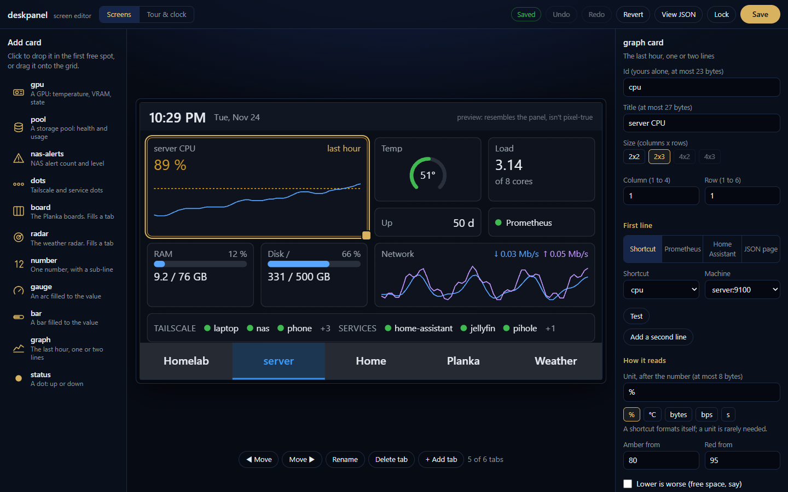

# The screen editor

`<server-ip>`, `<repo>`, **the server** and **the PC** mean the same on every page: see [Words used in these pages](README.md#words-used-in-these-pages). [Back to the index](README.md).

## Edit your tabs in the browser?

The screen editor is a web page on the aggregator: drag cards around a
picture of the panel, pick what each one shows from lists of your own GPUs, pools, Prometheus metrics and
Home Assistant entities, and press Save. It writes the same `layout.json` as [Make my own tab](layout.md#make-my-own-tab), so you can
use the page, a text editor, or both.



1. **Turn it on.** Give it a password of its own, at least 12 characters, in `<repo>/aggregator/.env`:

   ```sh
   EDITOR_TOKEN=<a password of at least 12 characters>
   ```

   Something like `openssl rand -hex 16` makes a good one. It must be at least 12 characters and different from
   `PANEL_TOKEN` and `NOTIFY_TOKEN`; otherwise the editor stays off. Then, on the server:
   - Built from the checkout: `cd <repo>/aggregator && docker compose up -d --build` (the first time after
     updating), or `docker compose up -d --force-recreate` (later changes to `.env`).
   - Prebuilt image: `cd <repo>/aggregator && docker compose -f compose.image.yaml pull && docker compose -f compose.image.yaml up -d`.
2. **Open** `http://<server-ip>:8088/editor/` in a browser, type the password and press Unlock. The browser
   remembers it until you press Lock.
3. **Change things, press Save.** The server checks the layout with the same rules as the file, and shows the
   server's own message if it refuses. The panel follows in about 20 seconds. The file it replaced is kept as
   `layout.json.bak` next to it, so the last version is one `mv` away.
4. **Where does a card's data come from?** Each card's settings have a source picker. What a picker lists needs the
   matching line in `.env`: `PROMETHEUS_URL` for Prometheus metrics, `HA_URL` and `HA_TOKEN` for Home Assistant,
   and a `CARD_<NAME>` variable for a JSON page that wants a header. The page says which line is missing; GPUs and
   pools need nothing more than the aggregator already has.

## Good to know

- **Hand-editing still works.** The panel reads whatever is in the file. Two things to know: a save from the
  editor rewrites the whole file, one card per line, and **drops any key it doesn't know** (a note-to-self
  key you added by hand won't survive); and if you edit the file by hand while the page is open, Save
  refuses with `layout.json changed on disk; reload` (the page adds that someone changed the file since it loaded
  it) and offers **Reload**, so the page never overwrites your edit. View JSON, then Download, keeps a copy of
  your version first.
- **The editor password is as powerful as write access to `layout.json`.** Whoever has it can read your Home
  Assistant entity names and states, Prometheus metric names, Planka card titles and the notification history.
  They can also rewrite the tabs, and point a card (or the page's Test button) at any address the server can
  reach. The page only ever shows the *names* of your `CARD_*` variables, never their values, but the server
  sends a card's `CARD_*` header to whatever address that card names, exactly as it would for someone who can
  edit `layout.json`. Make the password long and random, use it nowhere else, and keep the aggregator on your LAN.
- **No `EDITOR_TOKEN`, or one under 12 characters?** The page doesn't exist: `/editor/` answers "not found", and
  the aggregator's log has a line containing `editor off:` (after the date and time) that says why.
- **Try it first, with made-up data:** the [flasher site](https://zebadrabbit.github.io/deskpanel/editor/) has the
  same editor with nothing behind it. Nothing is saved; **Download layout.json** gives you the file to put in
  `aggregator/config/`.

## Tour settings

The editor's **Tour & clock** view sets the idle tour: on or off, how long the panel sits idle first, how long
the clock and each tab stay up, and which tabs it visits. The keys, their limits and the firmware it needs are
in [Change how the idle tour behaves?](layout.md#change-how-the-idle-tour-behaves)

## Upgrading from an older checkout?

Save writes into `aggregator/config/`, so the compose file you use
(`compose.yaml`, or `compose.image.yaml` for the prebuilt image) must mount it as `./config:/config` **without**
`:ro`. Both files in this version do. If you copied an older one, change that line, then recreate the container
(`docker compose up -d --build`; for the image, `docker compose -f compose.image.yaml pull`, then `up -d` with the
same `-f`). Until you do, Save answers "can't write ... Mount config without :ro" and nothing is lost.
