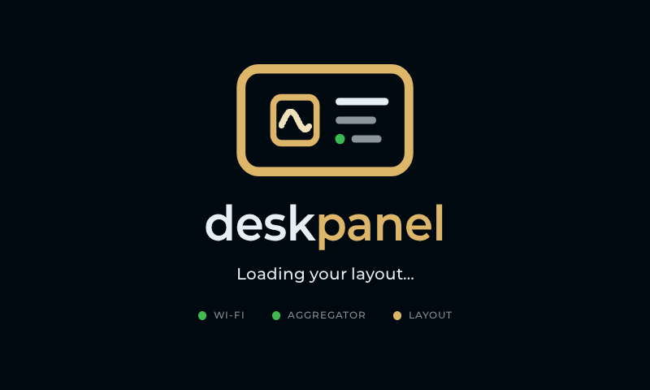

# Getting started

`<server-ip>`, `<repo>`, **the server** and **the PC** mean the same on every page: see [Words used in these pages](README.md#words-used-in-these-pages). [Back to the index](README.md).

Two ways to install: [the easy way](#install-the-easy-way), with nothing to compile, or
[build your own](#build-your-own). Then: [first boot](#first-boot), [`settings.txt`](#settingstxt) and
[the `.env` essentials](#the-env-essentials).

## Install the easy way

Nothing to compile. You need the board, a microSD card and a Linux machine with Docker.

1. **Flash the panel from your browser.** Open the [flasher page](https://zebadrabbit.github.io/deskpanel/) in
   Chrome or Edge, plug the panel in over USB-C and click **Connect & flash**.
2. **Make its `settings.txt`** on the same page: Wi-Fi, server address, token, time zone. The file is made in
   your browser; nothing is sent anywhere. Copy it to the top folder of the microSD card (FAT32), put the card in
   the panel and restart it.
3. **Start the aggregator** from the prebuilt image (amd64 or arm64):
   ```sh
   git clone https://github.com/zebadrabbit/deskpanel && cd deskpanel/aggregator
   cp .env.example .env    # PANEL_TOKEN (the one in settings.txt), LISTEN, TZ, then the sources you have
   docker compose -f compose.image.yaml up -d
   ```
   **Just trying it?** No homelab needed, fake data:
   `docker run -d --name deskpanel -p 8088:8088 -e DEMO=1 -e PANEL_TOKEN=<token> ghcr.io/zebadrabbit/deskpanel-aggregator`

Rather build everything yourself? See [Build your own](#build-your-own).

## Build your own

The alternative to [the easy way](#install-the-easy-way): build the firmware with your values built in, and the
aggregator image locally. You need:
- the Waveshare **ESP32-S3-Touch-LCD-4.3B** (the **B** variant)
- a Linux server with **Docker**
- optionally: TrueNAS SCALE 25.04+, NVIDIA GPUs, Tailscale, Planka 2.x and Claude Code. Each part is
  optional: leave its URL empty and that collector is skipped.

1. **Aggregator**: `cd aggregator && cp .env.example .env`, fill it in (each variable is explained in
   [aggregator/README.md](../aggregator/README.md)), then `docker compose up -d --build`.
   **No homelab yet?** Set `DEMO=1` (plus `PANEL_TOKEN` and `LISTEN`) and the panel comes alive with
   fake GPUs, pools, services, task boards where Done works, and notifications.
2. **GPU agents** (optional): `sh aggregator/dist.sh` builds the binaries. Install them per
   [aggregator/README.md](../aggregator/README.md#deploy-the-gpu-agents).
3. **Firmware**: `cp firmware/main/secrets.example.h firmware/main/secrets.h`, fill it in (Wi-Fi, address and
   token can later come from `settings.txt` on the SD card instead), then
   `sh firmware/build.sh` on a machine with Docker. Flash it with `firmware/flash.ps1` (Windows), or
   from `firmware/build/` with `python -m esptool --chip esp32s3 -p <port> write_flash @flash_args`.
4. **Claude Code hooks** (optional): see [Get Claude notifications on a computer?](how-to.md#get-claude-notifications-on-a-computer).

## First boot



At power-on the panel shows the startup screen: the logo, one line of text and three dots, **WI-FI**,
**AGGREGATOR** and **LAYOUT**. A green dot is done, a brass one is being worked on. The screen shows for about
3 s, then stays until a layout is on screen, and fades into your tabs.

| The line says | It means |
|---------------|----------|
| **Joining Wi-Fi…** | The panel is joining its network. |
| **Waiting for the aggregator…** | Wi-Fi is up, no answer from the aggregator yet. |
| **Loading your layout…** | The aggregator answered and the panel is fetching its tabs. After an aggregator restart without a layout file this can last up to 25 s. |
| **Wi-Fi isn't set up yet.** ([looks like this](screenshots/first-boot.png)) | Firmware from the flasher page has no Wi-Fi built in and found no usable `settings.txt`. Make one ([below](#settingstxt)), put it on the card and restart. |
| **Update the aggregator to use layouts** ([looks like this](screenshots/startup-404.png)) | The aggregator is older than the firmware. Update it: [Update the aggregator?](how-to.md#update-the-aggregator) |

If it stays on one line for more than half a minute, see
[Troubleshooting](troubleshooting.md#when-something-looks-wrong), the row "The startup screen (the logo) stays".

## settings.txt

**Change the panel's Wi-Fi, aggregator address or token without rebuilding?**

1. Power the panel off and take out the SD card.
2. On the PC, make `settings.txt` in the card's top folder (Notepad is fine, or let the
   [flasher page](https://zebadrabbit.github.io/deskpanel/) make it) and paste the lines below. As
   pasted they change nothing: remove the `#` from each line you want, and fill in your value. Each such line
   replaces the built-in value:
   ```
   # settings.txt: one KEY=value per line, no quotes. A line starting with # is ignored.
   # WIFI_SSID=MyNetwork
   # WIFI_PASSWORD=my wifi password
   # AGGREGATOR_URL=http://192.0.2.10:8088
   # PANEL_TOKEN=the PANEL_TOKEN from aggregator/.env
   # DESKPANEL_TZ=CST6CDT,M3.2.0,M11.1.0
   # NTP_SERVER=pool.ntp.org
   ```
3. Put the card back and power on. The file is read once, at boot.

- **Check it:** the serial log (`python -m serial.tools.miniterm --raw COMx 115200`) shows
  `settings: from settings.txt: WIFI_SSID WIFI_PASSWORD`. Values are never printed. A mistake shows as
  `settings.txt line 3: …`. `settings: built in (no settings.txt)` means the panel didn't find it: check that
  Windows didn't save it as `settings.txt.txt` (View → File name extensions).
- **Format:** spaces around `=` and at a line's end are ignored, so a password can't start or end with a space.
  `#` starts a comment only at the start of a line. `AGGREGATOR_URL` is `http://host:port` (plain http only; a
  path after it is fine). Keys are in capitals, exactly as above.
- **Limits:** SSID 31 characters, password 63, URL and token 95, the others 63. Longer lines are ignored. A file
  over 4 KB is ignored whole.
- **Undo:** delete the line, the file, or the card: the built-in values come back.
- **An empty value sets it empty** (`WIFI_SSID=` turns Wi-Fi off). To keep the built-in value, delete the line.
- **A wrong Wi-Fi password means no network** (amber Wi-Fi icon) until you fix the file. There's no fallback.
- **The panel never writes this file.** It holds the Wi-Fi password and the token in plain text, so whoever has
  the card can read them.
- **Changing the built-in values** still means `firmware/main/secrets.h`, then build and flash (see [Update the panel's firmware?](how-to.md#update-the-panels-firmware)).

## The `.env` essentials

The aggregator reads its settings from `aggregator/.env`. Copy `aggregator/.env.example` to `.env` and fill in
what you have. `PANEL_TOKEN` and `LISTEN` are needed even for the demo. Every source is optional.

| Variable | What to put |
|----------|-------------|
| `PANEL_TOKEN` | The token the panel sends. Make one with `openssl rand -hex 24`. The same value goes in `settings.txt` (or `secrets.h`). |
| `LISTEN` | `<server-ip>:8088`. Use the server's LAN address, not just `:8088`, so the API stays on your LAN and off the tailnet. |
| `TZ` | Your time zone, for example `America/Chicago`. Unset means UTC. Keep it the same zone as the panel's `DESKPANEL_TZ`. |
| `NOTIFY_TOKEN` | A separate token for anything that sends notifications, so a notifier can't mark cards done. Empty turns notifications off. `openssl rand -hex 24`. |
| `DEMO` | `DEMO=1` replaces every source with fake data. |
| `EDITOR_TOKEN` | The password that switches on [the screen editor](editor.md). Empty means off. |

Then the sources you have. Leave a source's URL empty to turn it off.

| Source | Variables | More |
|--------|-----------|------|
| TrueNAS | `TRUENAS_URL`, `TRUENAS_USER`, `TRUENAS_API_KEY`, `TRUENAS_CERT_SHA256` | [aggregator/README.md](../aggregator/README.md#config-env) |
| GPU machines | `GPU_AGENTS` | [Add another GPU machine?](how-to.md#add-another-gpu-machine) |
| Service dots | `SERVICES` | [Add a service dot?](how-to.md#add-a-service-dot) |
| Tailscale | `TAILSCALE_SOCKET` | [aggregator/README.md](../aggregator/README.md#config-env) |
| Planka | `PLANKA_URL`, `PLANKA_USER`, `PLANKA_PASSWORD` | [Show a Planka board on the panel?](how-to.md#show-a-planka-board-on-the-panel) |
| Weather and the clock's sky | `WEATHER_LAT`, `WEATHER_LON` | [Set up the weather?](screen.md#set-up-the-weather) |
| Prometheus | `PROMETHEUS_URL` | [Cards](cards.md#general-cards-any-prometheus-number) |
| Home Assistant | `HA_URL`, `HA_TOKEN` | [Cards](cards.md#general-cards-home-assistant) |
| An app's JSON page that wants a login | `CARD_<NAME>` | [Cards](cards.md#general-cards-a-number-or-word-from-an-apps-json-status-page) |

The container only reads `.env` when it is created, so after a change run
`cd <repo>/aggregator && docker compose up -d --force-recreate` (with the prebuilt image add
`-f compose.image.yaml` after `compose`). Every variable is explained in
[aggregator/README.md](../aggregator/README.md#config-env).

## Next

- [What's on the screen](screen.md): what each tile, colour and badge means.
- [The screen editor](editor.md) or [layout.json](layout.md): make the tabs your own.
- [How do I…](how-to.md): notifications, Claude Code hooks, updates.
