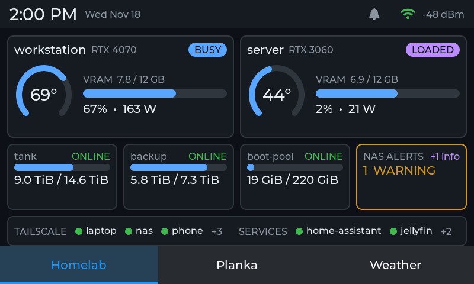
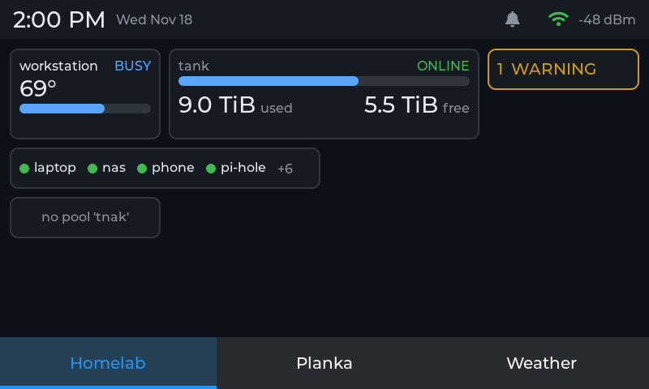

# Your own tabs: layout.json

`<server-ip>`, `<repo>`, **the server** and **the PC** mean the same on every page: see [Words used in these pages](README.md#words-used-in-these-pages). [Back to the index](README.md).

On this page: [make a tab](#make-my-own-tab), the grid, the fields, card types and sizes, taps,
[what happens when you save](#what-happens-when-you-save) and
[the `tour` block](#change-how-the-idle-tour-behaves). What goes in a general card's `value`, and a GPU
card's `slots`, is in [Cards](cards.md). To do all this with the mouse, use [the screen editor](editor.md).

## Make my own tab?

The panel's tabs come from one file on the server, `aggregator/config/layout.json`.
Without it you get the default: **Homelab** (a card per GPU and pool, the NAS alerts and the dots),
**Planka** and **Weather**. Edit it by hand and the panel follows when you save (or use [the screen editor](editor.md)).



1. **Start from the default** (so the names of your own GPUs and pools are already in it). On the server (in its own shell, not Windows PowerShell, whose `>` would write UTF-16):

   ```sh
   cd <repo>/aggregator
   docker compose run --rm -T deskpanel layout-default > config/layout.json
   ```

   Keep the **`-T`**. Without it Docker attaches a terminal, which mixes its messages into the file and
   turns every line ending into CRLF. This only reads your sources once; it doesn't touch the running
   aggregator. If none of your sources answer you get a template with `<gpu host>` and `<pool>` to fill
   in. (A copy to start from is in `aggregator/layout.example.json`.) The `config/` folder is mounted into
   the container, so the file is there as `/config/layout.json` with no rebuild.
2. **Edit it** in any editor and save. One tab looks like this:

   ```json
   {
     "tabs": [
       {
         "name": "Homelab",
         "cards": [
           {"id": "gpu-workstation", "type": "gpu", "at": [1, 1], "size": "2x3", "src": "workstation"},
           {"id": "pool-tank", "type": "pool", "at": [3, 1], "size": "1x2", "src": "tank"},
           {"id": "alerts", "type": "nas-alerts", "at": [4, 1], "size": "1x2"},
           {"id": "dots", "type": "dots", "at": [1, 4], "size": "4x1", "src": "both"}
         ]
       }
     ]
   }
   ```
3. **Wait about 20 seconds** (half a minute at most). The panel rebuilds its tabs by itself; there's nothing to restart or flash.
   Go back to the default at any time by deleting `config/layout.json`.

**The grid.** Every tab is 4 columns by 6 rows. `"at": [1, 1]` is the top-left square, `[4, 6]` the
bottom-right; `"size": "2x3"` is 2 columns wide and 3 rows tall. Cards can't overlap or leave the grid.

**The fields**

| Field | |
|-------|-|
| `tabs[].name` | The tab's name, shown in the bottom bar. At most 15 bytes, no two the same; keep it to plain letters (the tab font has no accents). |
| `cards[].id` | Any name that is yours alone, no two the same anywhere in the file, at most 23 bytes. |
| `type` | `gpu`, `pool`, `nas-alerts`, `dots`, `board` or `radar`, or one of the general cards `number`, `gauge`, `bar`, `graph`, `status` (see [Cards](cards.md)), or `light` or `profile` (see [Lights](lights.md)). |
| `at` | `[column, row]`, counting from 1. |
| `size` | `"WxH"`, one of the sizes in the table below. |
| `src` | Where the card gets its data (below). At most 27 bytes. |
| `title` | At most 27 bytes. The name on a general card; it has no effect on the built-in cards yet. |
| `tap` | What a tap on the card does (below). Optional. |

At most 6 tabs and 24 cards on a tab. The whole layout must also fit the panel's 12 KB: a file with a hundred or more small cards and long names is refused (by the editor on Save, or as a layout error in the file) with `too big for the panel (N bytes, at most M): use fewer cards`.

**Card types and sizes**

| Type | Shows | Sizes (columns x rows) | `src` |
|------|-------|------------------------|-------|
| `gpu` | temperature, VRAM, state | `2x3`, `2x2`, `1x3`, `1x2`, `1x1` | the GPU agent's name from `GPU_AGENTS` (`workstation`). A host's second GPU is `workstation#2` |
| `pool` | health and usage | `1x2`, `1x1`, `2x2` | the pool name as TrueNAS reports it (`tank`). Names over 24 bytes are cut to 24, as on the panel |
| `nas-alerts` | the alert count and level | `1x2`, `1x1` | none |
| `dots` | Tailscale and service dots | `4x1`, `2x1`, `4x2` | `tailscale`, `services` or `both` (the default) |
| `board` | the Planka boards | `4x6` | none |
| `radar` | the weather radar | `4x6` | none |
| `number` | one number, with a sub-line | `1x1`, `1x2`, `2x2` | none (it takes a `value`, see [Cards](cards.md#general-cards-any-prometheus-number)) |
| `gauge` | an arc filled to the value | `1x2`, `2x3` | none (`value`) |
| `bar` | a bar filled to the value | `1x1`, `1x2`, `2x1` | none (`value`) |
| `graph` | the last hour, one or two lines | `2x2`, `2x3`, `4x2`, `4x3` | none (`value`) |
| `status` | a dot: up or down | `1x1`, `2x1` | none (`value`: a `{"prometheus": …}` or `{"json": …}` query only, no shortcut) |
| `light` | a Home Assistant light or switch: tap toggles, hold for brightness and colour | `1x1`, `1x2`, `2x1`, `2x2` | none (`value`: `{"ha": "light.x"}` or a switch; see [Lights](lights.md)) |
| `profile` | a button that sets every light card | `1x1`, `2x1` | none (`title` required; see [Lights](lights.md)) |

A `4x6` card fills a whole tab, so it must be the only card on it.

**Taps.** `tap` is one of:
- `notifications`: opens the notification history, like the bell.
- `alert-details`: opens every NAS alert in full. This is what `nas-alerts` does by default.
- `tab:<name>`: jumps to that tab, for example `"tap": "tab:Planka"`. The tab must exist.
- `none`: nothing. This is the default for every other type.

`board` and `radar` already handle their own taps, so they take no `tap` (leave it out, or `none`).

## What happens when you save

- The aggregator looks at the file every 5 seconds and loads it once it has stayed the same on two looks,
  so a half-saved file is never read. The panel polls every 15 s, so allow about 20 s in all, half a minute at most.
- An editor that saves by deleting and re-creating the file is fine; a file that is missing for a few
  seconds is ignored.
- **Save as UTF-8.** A byte-order mark (what Windows editors add) is fine. UTF-16, which Notepad's
  "Unicode" and PowerShell 5.1's `>` write, is refused with "save as UTF-8".
- **A mistake** puts one notification on the panel that names the line, for example
  `layout.json line 7: 'gpu-server' size 3x3 not allowed for gpu`. The tabs keep
  showing the last good layout until you fix the file (after a server restart with a broken file there is no last good one, so you get the default until it's fixed). You get one note per bad save, not one per check.

**A card whose source isn't there** still draws, dimmed, saying what's missing: `no gpu 'workstation'` or
`no pool 'tnak'`. It fixes itself when the source appears. A typo is the usual cause.



## Change how the idle tour behaves?

Open the screen editor (see [The screen editor](editor.md)) and
choose the **Tour & clock** view: switch the tour off, set how long the panel sits idle first, how long the
clock and each tab stay up, leave the clock out, or untick a tab in the **Tabs the tour visits** list to skip it. Save, and the panel follows
in about 20 seconds. The settings are the `tour` block of `layout.json`, which you can also write by hand, next to
`tabs`. Every key is optional:

```json
{"tour": {"on": true, "idle_min": 5, "clock_s": 60, "tab_s": 20, "clock": true, "skip": ["Planka"]}}
```

| Key | Means | Allowed | Default |
|-----|-------|---------|---------|
| `on` | `false` turns the tour off | `true` / `false` | `true` |
| `idle_min` | minutes of nobody touching the panel before it starts | 1 to 120 | 5 |
| `clock_s` | seconds on the clock | 5 to 600 | 60 |
| `tab_s` | seconds on each tab | 5 to 600 | 20 |
| `clock` | `false` leaves the clock out of the tour | `true` / `false` | `true` |
| `skip` | names of tabs the tour passes over | existing tab names | none |

**It needs firmware that reads the `tour` block (any built since late November 2026).** Update the server first, then the panel's firmware (see [Update the aggregator?](how-to.md#update-the-aggregator) and
[Update the panel's firmware?](how-to.md#update-the-panels-firmware)). Older firmware ignores the block and keeps 5 minutes,
60 s and 20 s. A tab name in `skip` that doesn't exist is a
layout error, like any other.
