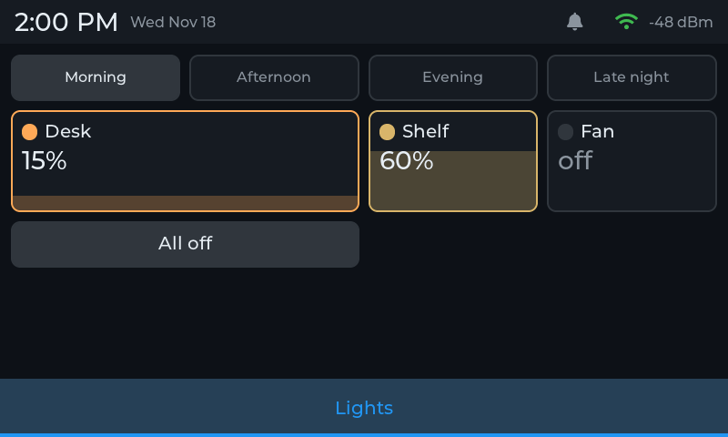
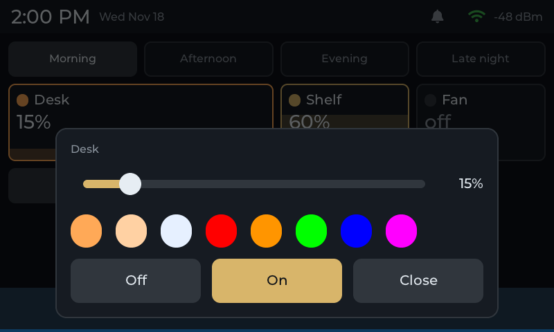

# Lights

Turn Home Assistant lights on and off from the panel, dim them, pick a colour, and set the whole room with one
press. Words like *the server* and `<repo>` are explained in the [index](README.md#words-used-in-these-pages).



There are two cards, and a "Lights" tab is just a tab that holds them. You can also put a single light on any
other tab.

| Card | What it is | Tap | Hold |
|------|------------|-----|------|
| `light` | One Home Assistant light or switch | Turns it on or off | Opens brightness and colour, if the light has them |
| `profile` | A button such as **Morning** or **All off** | Sets every light card to what the profile saved | Offers to save the lights as they are now |

## Set it up

1. **Connect Home Assistant** if you haven't: `HA_URL` and `HA_TOKEN` in `aggregator/.env`, with a token from a
   user who is allowed to control the lights
   ([Home Assistant cards](cards.md#general-cards-home-assistant) has the steps).
2. **Add the cards.** In the [screen editor](editor.md), add a `light` card and pick its entity from the list
   (lights and switches only). Add `profile` cards and give each a title. Save.
   By hand in `layout.json` they look like this:
   ```json
   {"id": "desk",    "type": "light",   "at": [1, 2], "size": "2x1", "title": "Desk", "value": {"ha": "light.desk"}},
   {"id": "morning", "type": "profile", "at": [1, 1], "size": "1x1", "title": "Morning"}
   ```
3. **Save your profiles on the panel**: see [Profiles](#profiles).

Sizes: a `light` is `1x1`, `1x2`, `2x1` or `2x2`; a `profile` is `1x1` or `2x1`. The `1x2` tile is close to
square and shows the brightness best. A layout holds at most 24 light cards.
A switch entity (a smart plug, say) works as a `light` card that only goes on and off.

## A light tile

The tile shows the light's name, a dot and its state: `off`, `on`, or its brightness such as `15%`. While the
light is on, the tile fills from the bottom up to its brightness, and the dot, the fill and the tile's outline
take the light's colour.

- **Tap** to turn it on or off. The tile changes at once and corrects itself if Home Assistant says otherwise.
- **Hold** for its controls:



  - A **brightness slider**, for lights that dim. The light changes when you let go.
  - **Colour buttons**, only the ones the light can do: soft, neutral and cool white for lights with colour
    temperature; red, amber, green, blue and magenta for colour lights.
  - **On / Off** and **Close**.

A light that only dims gets the slider and no colours. A switch has no controls, so holding it does nothing.

## Profiles

A profile remembers what **every light card on the panel** was doing when you saved it: which were on, how
bright, which colour. Pressing it puts them all back that way.

- **To save one:** set the lights the way you want them, hold the profile button, and choose **Save**.
  A button that has never been saved says so, and a tap on it tells you to hold it.
- **To use one:** tap it.
- **"All off"** is an ordinary profile: turn everything off, then save it under that name.
- A light you add later is not in the profiles you saved before. Save them again to include it.

Profiles are kept on the server, in `profiles.json` next to the notification history (`PROFILES_FILE` changes
the place), so they survive restarts of the server and the panel. They are stored under the profile card's `id`:
if you change a card's id, save that profile again.

## What the panel is allowed to do

This is the one place where the panel changes something outside deskpanel, so the limits are narrow:

- The panel names a **card**, never an entity. The server looks the card up in the current layout and acts on
  that card's entity. An entity that is not a light card in your layout cannot be touched.
- Only these actions exist: on, off, toggle, brightness, the eight colours above, and applying or saving a
  profile.
- They use the panel's token, like marking a task card done. Anyone holding that token on your network can
  switch the lights in your layout, and nothing else in Home Assistant.

## When something looks wrong

| What you see | What it means | What to do |
|--------------|---------------|------------|
| A tile says **set HA_URL** or **set HA_TOKEN** | Home Assistant isn't connected | Add the line to `aggregator/.env` and restart the aggregator |
| **bad token** / **forbidden** | Home Assistant rejected the token, or banned the server's address | Make a new token; for a ban, clear it in HA's `ip_bans.yaml`. The server stops trying until the token changes |
| **no entity** | The entity id doesn't exist | Pick it again in the editor |
| **unavailable** | Home Assistant's own word: the bulb is unpowered or off the network | Check the bulb. The tile ignores taps until it is back |
| **unreachable** | No answer from Home Assistant | Check `HA_URL` and that Home Assistant is up |
| A tile flips back and a note says **Home Assistant didn't answer** | The request reached the server, but Home Assistant refused it or timed out | Try again; if it repeats, look at `docker compose logs --tail 30` |
| **That light can't do that** | A colour or brightness the light doesn't support | Nothing: the controls normally hide what a light can't do |
| Saving the layout says **id '…': letters, digits, - _ . only** | A light or profile card's `id` has a space or another character that can't go in a web address | Rename the id. The editor's own ids are always fine |
| One tap, then every Home Assistant card says **bad token** | The token's user may read the light but not control it, and Home Assistant answered the attempt with a refusal | Use a token from a user who can control the lights, then restart the aggregator |
| A damaged `profiles.json` | The server sets it aside as `profiles.json.bad` and starts with no profiles; its log says so | Fix the file and put it back while the server is stopped, or save the profiles again on the panel |
| A profile button says **not saved** | Nothing has been saved under it yet | Hold it and save |
| A profile misses a light | The light was added after the profile was saved, or was unreadable at that moment | Save the profile again |
| Profiles are gone after a server restart | The server had nowhere to keep them (`NOTES_FILE` and `PROFILES_FILE` both unset); its log says so at start | Set one of them. The compose files in this repository already do |
| A change takes a second or two to show | The tile waits for Home Assistant's own answer | Normal. If it is longer, the server or Home Assistant is slow to answer |

For developers: the routes are in [aggregator/README.md](../aggregator/README.md), the cards in
`firmware/main/card_light.c` and `card_profile.c`.
