# The screen: pages, notifications, clock and weather

`<server-ip>`, `<repo>`, **the server** and **the PC** mean the same on every page: see [Words used in these pages](README.md#words-used-in-these-pages). [Back to the index](README.md).

On this page: [the pages and the status bar](#whats-on-the-screen), [notifications](#whats-on-the-screen),
[the idle tour and the astronomical clock](#idle-tour-and-astronomical-clock),
[setting up the weather](#set-up-the-weather).

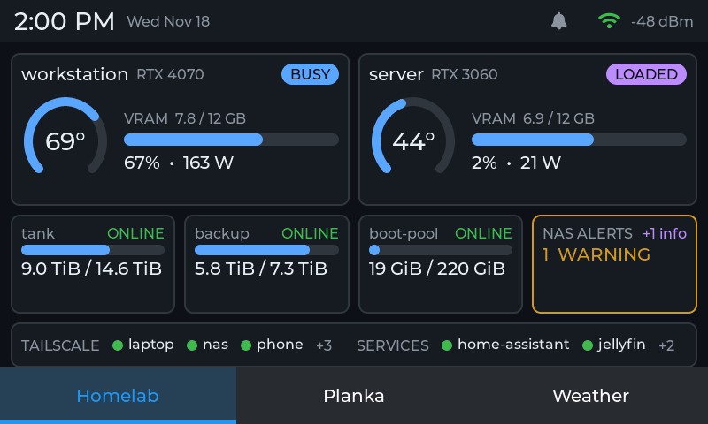

| A notification pops up | NAS alerts, one tap away | Notification history |
|---|---|---|
| 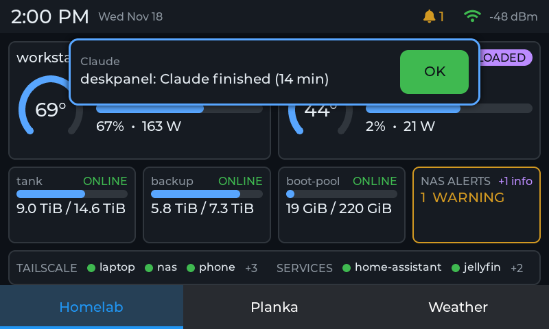 | 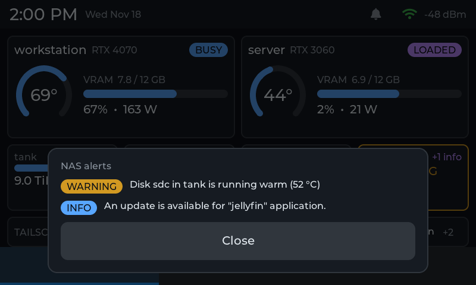 | 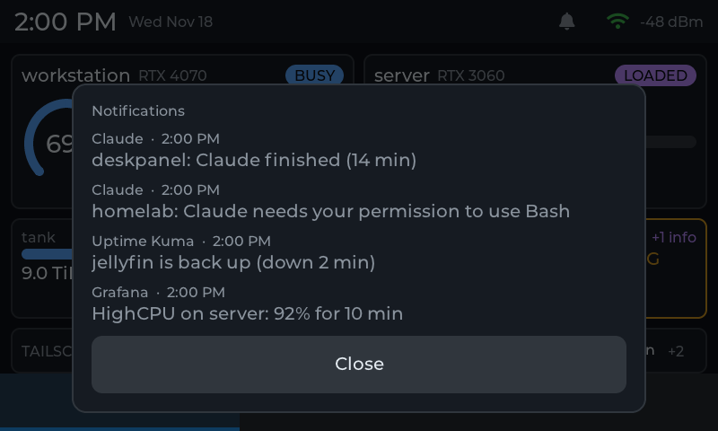 |
| **Task boards** | **Tap a card to finish it** | **Done, straight to Planka** |
| 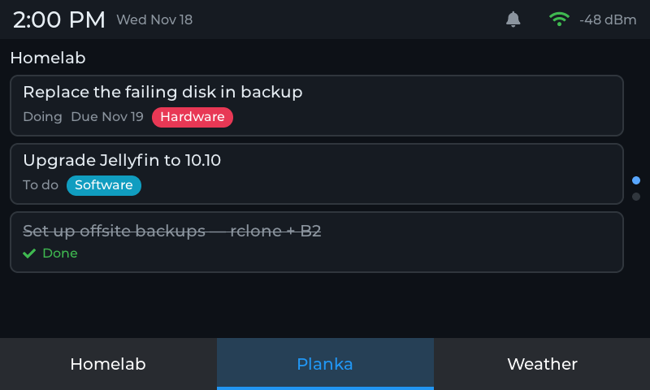 | 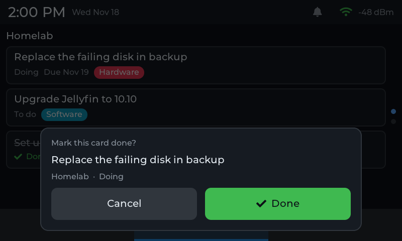 | 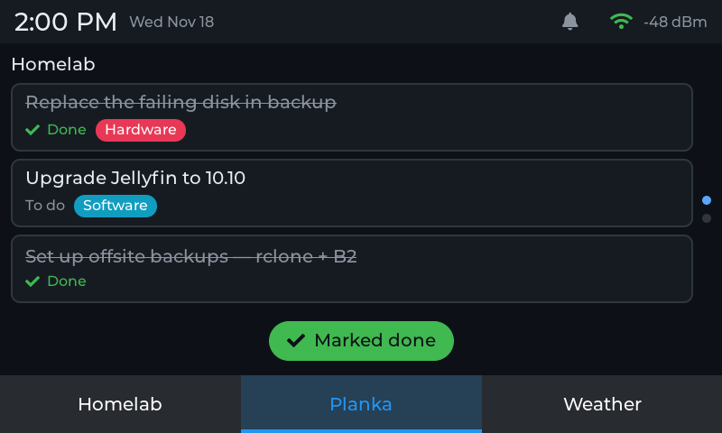 |
| **Weather radar loop** | **Conditions** | **Tornado warning takeover** |
| 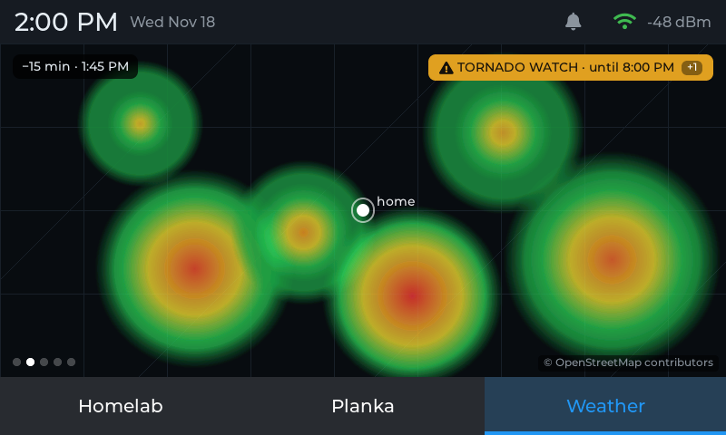 | 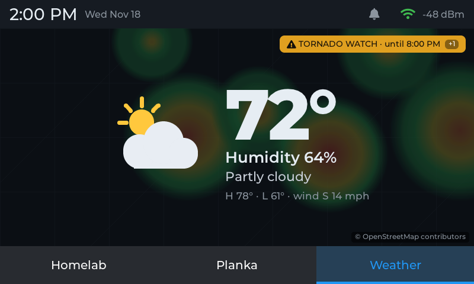 | 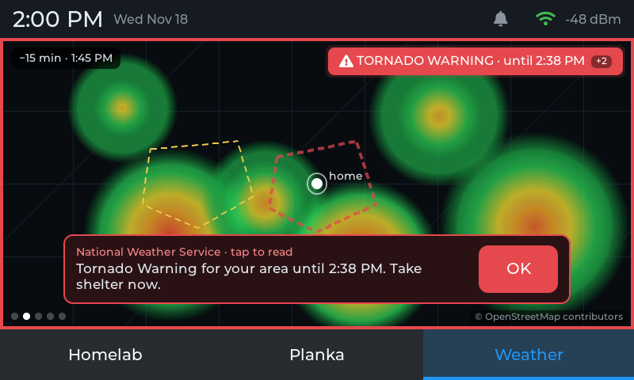 |
| **Astronomical clock** | **By day** | **Left alone, it tours its tabs** |
| 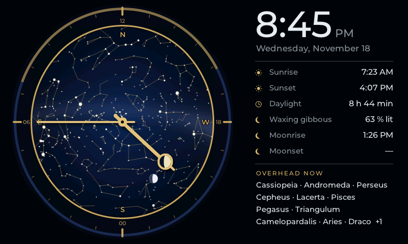 | 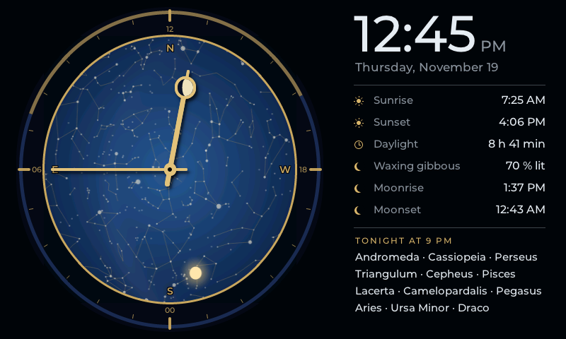 | 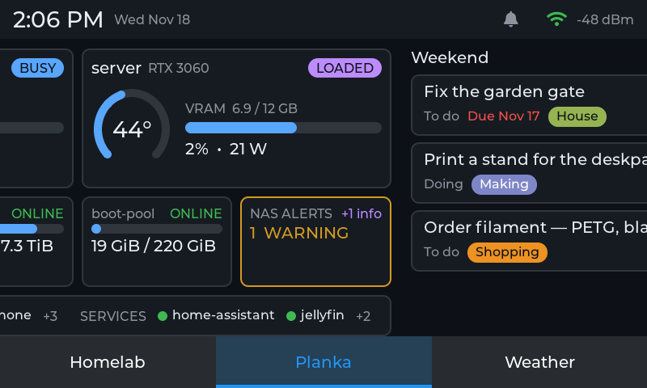 |

<details><summary>The whole tour, animated</summary>


</details>

The screenshots come from the [PC simulator](../firmware/README.md#pc-simulator): the panel's real UI code,
rendering the aggregator's demo data.

## What's on the screen

**Status bar** (top, left to right)

- **Clock and date**: internet time, kept by the onboard clock through power cuts. **Tap the time** for
  the astronomical clock (see [Idle tour and astronomical clock](#idle-tour-and-astronomical-clock)).
- **NO DATA / STALE 45s** (amber pill): the panel hasn't heard from the aggregator for 30 s or more.
  Everything below greys out but stays readable. No pill means everything is fresh.
- **Bell**: grey means nothing new; amber with a number means unread notifications. **Tap it** for the history.
- **Wi-Fi**: green with signal strength (dBm) when connected, amber while joining, grey when off.

**Bottom tabs**: **Homelab**, **Planka** and **Weather** unless you have laid out your own (see [Make my own tab](layout.md#make-my-own-tab)). Tap a tab or swipe left/right.

**Homelab page**

- **GPU tiles**, one per GPU machine:
  - A temperature arc: amber from 80 °C, red from 90 °C.
  - A VRAM bar, plus use % and watts.
  - A badge: **IDLE** (grey); **LOADED** (violet: a model is sitting in memory but not working,
    e.g. Ollama); **BUSY** (blue); **OFF** (dimmed: that machine's agent isn't answering, so it's
    off or asleep).
- **Pool tiles**:
  - Health: green ONLINE, red anything else.
  - A usage bar: amber from 85 %, red from 95 %.
  - The boot pool is the last tile.
- **NAS ALERTS tile**: "All clear", or a count like "2 CRITICAL".
  - Frame: **violet** means only info alerts (app updates and the like), **amber** warnings,
    **red** errors.
  - **Tap it** to read every alert in full.
- **Bottom row**: **TAILSCALE** dots (green online, grey offline) and **SERVICES** dots (green up,
  red down).

**Planka page**

- One tile per Planka board that the `deskpanel` user is a member of (up to 6, alphabetical).
  - **Swipe up/down** to flip boards; the dots on the right show which one you're on.
  - It flips by itself every 10 s unless you touched it in the last 30 s.
- Each board shows its **3 most recently changed cards** (a new comment counts).
  - For each card: name, list, due date (amber within a day, red when overdue) and labels.
  - Cards already in Done are crossed out with a ✓.
- **Tap an open card → Done.**
  - It ticks straight away and moves to the board's Done list in Planka.
  - If that fails, it un-ticks and tells you why.

**Weather page** (US only; it needs a location, see [Set up the weather](#set-up-the-weather))

- **The radar loop.** Five frames, 5 minutes apart, play over a dark map with your spot marked, then a
  pause on the newest. About every 20 s the radar fades to the **conditions**: temperature, a sky icon,
  the high and low, and the wind. Then it fades back.
  - **Time chip** (e.g. "−10 min · 2:05 PM"): how old the frame on screen is, and its clock time.
    The **dots** show which of the five you're on.
  - **Amber time chip**: the radar is stuck. The newest frame is more than 15 minutes old, so the
    chip counts from now instead. The radar service is late or unreachable; nothing is wrong with the panel.
- **The alert badge** (top corner), for alerts that cover your spot:
  - **amber**: a watch (conditions are right for it, nothing is happening yet).
  - **red, pulsing**: a warning (it's happening or about to).
  - **yellow-amber**: an advisory (an inconvenience, like wind or fog).
  - **+2** next to it means two more alerts; the badge shows the most severe.
  - **Tap the badge** for the full text of each alert, as the NWS wrote it. The alerts are chips in
    one row across the top; tap one to read it. With more than fit, the row is cut off at the right:
    **swipe it sideways** for the rest. Below, the headline, when it was issued and expires, the
    details (each **WHAT... / WHERE... / HAZARD...** heading in yellow) and, in a red-edged box, what to do.
  - If the sheet says **"These alerts have changed. Close and reopen to read them."**, the list of
    alerts changed while the sheet was open (one was added, ended or moved), so that chip's slot now
    holds a different alert. An update to the same alert just shows its new text.
    Close the sheet and open it again and it shows the current text.
- **Outlines** on the map are warnings that are on the radar right now, not only at your spot:
  **red** is a tornado warning, **yellow** a severe thunderstorm warning. The one over your spot is
  **thicker and pulses**. Outlines show over the radar only; they fade out while the conditions show.
- **The tornado takeover.** A **Tornado Warning** (or an Extreme Wind Warning) for your spot grabs the
  panel, wherever it was:
  - It jumps to the Weather tab and stays on the radar. The frame goes **red**.
  - A **sticky notice** says "Tornado Warning for your area until 3:30 PM. Take shelter now."
    Nothing hides it but **its own OK**: tapping another tab or swiping doesn't.
  - If the warning is upgraded, the wording changes and the notice comes back even if you'd tapped OK:
    "… — tornado observed.", "… — considerable damage threat.", or "TORNADO EMERGENCY for your area
    until 3:30 PM." The badge says TORNADO OBSERVED, DANGEROUS TORNADO or TORNADO EMERGENCY.
  - If the panel restarts during a warning, the notice comes back (the aggregator remembers it).
  - When the warning expires or is cancelled, the red frame goes, the panel returns to normal, and a
    "Tornado Warning ended" note lands in the bell. The same note lands if the warning is downgraded
    in place (the NWS keeps the alert but it is no longer a Tornado Warning).
- **"Can't reach NWS for 10+ min"** (amber note in the bell, with "NWS is back" later): the alerts feed
  has been failing for 10 minutes. The panel can't tell you about new warnings while that lasts.

**This adds to your phone's emergency alerts and weather radio. It does not replace them.** The panel
polls once a minute, so a warning can show up a minute or two after the siren. Don't rely on a screen
beside your keyboard to tell you to take shelter.

**Notifications**

- A message pops up under the status bar with an **OK** button.
  - Leave it and after 30 s it tucks itself into the bell.
  - Tap the bell to see the last 20, newest first. Opening the history marks them read.
- **The aggregator tells you when something changes**:
  - **red**: a service is down, a pool turns unhealthy or passes 95 % full, a TrueNAS error, or
    a GPU at 90 °C or hotter.
  - **amber**: a pool passes 85 % full, a TrueNAS warning, or TrueNAS, Tailscale or Planka not
    answering for 2+ minutes.
  - **blue**: things coming back ("jellyfin is back up", "Pool … is healthy again").

  It only speaks on changes. Starting it up never re-announces what was already true; the tiles
  show standing problems.
- History survives aggregator restarts, and, with an SD card in the panel, panel restarts too.
- **Claude Code** (with the hooks installed) sends these automatically:
  - **amber** "<project>: Claude needs your permission…": it's stuck waiting for you to allow
    something.
  - **blue** "…waiting for your input": it's idle and waiting for you.
  - **"<project>: Claude finished (14 min)"**: a long task is done. Only for tasks that ran
    2 minutes or more.

**After a power cut**, with an SD card in the panel, the last data comes back immediately, greyed
with **STALE 3h** etc., until fresh data arrives. Without a card, the panel shows "Waiting for the
aggregator…" until fresh data arrives.

## Idle tour and astronomical clock

| The tour comes home to the clock | Then each tab for 20 s | A tornado warning ends it |
|---|---|---|
| 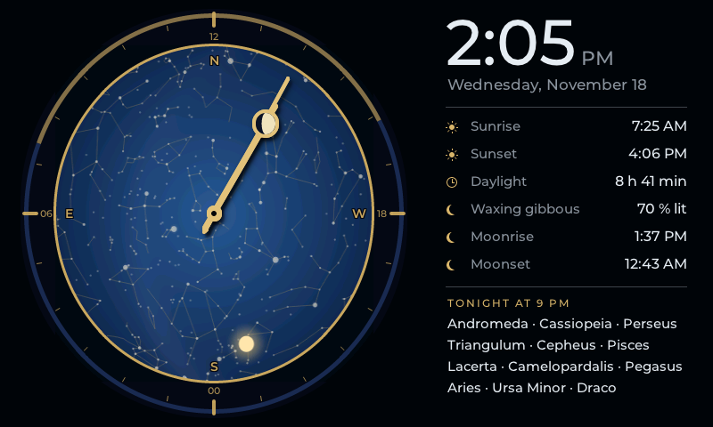 | 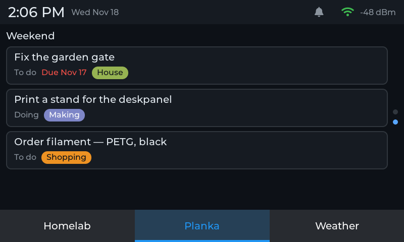 | 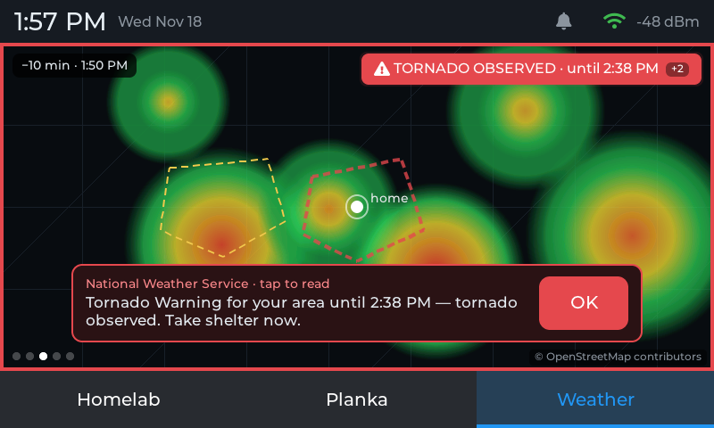 |

The clock screenshots show the sky over Greenwich, London, the demo's location. The tour shots read US Central time over that sky, so a 2 PM clock under a night sky is not a bug. The clock and the gauges are drawn about 6 % narrower so they're round on the panel's glass; the simulator's square pixels make them look slightly tall.

**Open the clock** by tapping the time at the top left of the status bar. It fills the whole screen.
**Tap anywhere on it** to go back where you were; that tap presses nothing underneath.

**The dial is a 24-hour clock**: noon at the top, midnight at the bottom, 06 on the left, 18 on the right.
- **The outer ring** is gold from sunrise to sunset and navy through the night.
- **The hour hand** goes round once a day, so it points to where the sun is in its day: inside the gold
  while the sun is up, in the navy after dark.
- **The ring on the hour hand** is the moon, filled to its phase: lit on the right while it's growing
  (waxing), on the left while it's shrinking (waning).
- **The minute hand** goes round once an hour, as usual. There's no second hand: the hands move once a
  minute, which is kinder to the screen.

**The round sky** is the sky over your spot right now, as if you lay on your back and looked up, like a
star chart held over your head:
- The middle is straight overhead and the gold rim is the horizon. North is at the top, and **east is on
  the left** (that's not a mistake: it's how the sky looks from below).
- Every star you could see from a town (down to magnitude 4.5), with the stick figures of all 88
  constellations in gold.
- The Milky Way, a soft pale band.
- The moon where it is, showing its phase, while it's above the horizon.
- **By day** the sun is drawn where it is, the sky turns a lighter blue and the stars soften. They stay,
  as on a real astronomical clock. Through dusk and dawn (the sun up to 12° below the horizon) the colour
  blends from one to the other.
- The server redraws it every 2 minutes, so it turns slowly with the real sky.

**The column on the right**
- The time and date.
- Sunrise, sunset and how long the day is; the moon's phase and how much of it is lit; moonrise and
  moonset.
  - A **—** means it doesn't happen today. The moon rises about 50 minutes later each day, so about once
    a month a day has no moonrise, or no moonset.
- **OVERHEAD NOW**: the constellations with a star more than 40° up, highest first. Whatever doesn't fit
  on 4 lines becomes "+3" (three more).
- From sunrise to sunset, and before 9 PM, it reads **TONIGHT AT 9 PM** instead: what will be overhead at 9 this evening. (A summer evening with the sun still up after 9 PM stays on OVERHEAD NOW.)

**The idle tour.** When nobody has touched the panel for **5 minutes** (you can change that, see
[Change how the idle tour behaves?](layout.md#change-how-the-idle-tour-behaves)), it tours by itself:
1. The clock for 60 s, then each tab in order for 20 s (sliding from one to the next), then the clock
   again, round and round.
2. **Your first touch only stops the tour.** It never presses a button, opens a sheet or marks a card
   done; touch again for that.
   - On a tab, the panel stays on that tab.
   - On the clock, the clock closes and you're back on the tab you were on before the tour started.
3. **A tornado warning beats it.** The notice shows, the clock closes, the tour stops and the panel jumps
   to the radar, exactly as it does without the tour.
4. **A notification pop-up stops it.** So does a change to your tabs (`layout.json`). Either way, the
   5 minutes start again.
5. **It waits for you.** The 5 minutes don't count while a sheet (the alert details, the notification
   history, the Done question), a notification pop-up or the tornado notice is open. They start when it
   goes, whether you answered it or not.
6. A clock you opened yourself stays until you tap it; the tour doesn't take it over.
7. The Planka boards keep flipping by themselves during the tour, as they always do.

**Set it up.** The clock uses the weather's settings: `WEATHER_LAT`, `WEATHER_LON` and `TZ` in
`aggregator/.env` (see [Set up the weather?](#set-up-the-weather)). The sky and the times are worked out on the server
from built-in star data, with no extra service to sign up for. Without a location, the clock still keeps
time over a plain dark sky and says "Set WEATHER_LAT/LON for the sky". The panel has its own time zone,
`DESKPANEL_TZ` in `firmware/main/secrets.h` (or a `DESKPANEL_TZ=` line in `settings.txt`, see
[settings.txt](getting-started.md#settingstxt)): keep it the same zone as `TZ`, or the hour hand won't line
up with the gold daylight arc.

**When the server is away**, the time and the hands keep running from the panel's own clock, and the
last sky and column stay on screen. After 10 minutes without the server the sky dims. With an SD card
they come back after a restart too. Before any data has ever arrived, it shows a plain dark sky and "—".

**Sky credits.** Star positions and the 88 constellation figures are trimmed from
[d3-celestial](https://github.com/ofrohn/d3-celestial) by Olaf Frohn (BSD 3-Clause). Its stars come from
XHIP, an extended Hipparcos catalogue, and its figures and names follow the IAU's. Details:
[aggregator/skydata/LICENSE](../aggregator/skydata/LICENSE).

**Change the tour's timing, or switch it off:** see
[Change how the idle tour behaves?](layout.md#change-how-the-idle-tour-behaves)

## Set up the weather?

US only: the radar and alerts come from NOAA and the National Weather Service.
Add these to `<repo>/aggregator/.env`, then `cd <repo>/aggregator && docker compose up -d --build`:

```sh
WEATHER_LAT=40.0000        # your spot, decimal degrees (a town is fine); leave empty to turn weather off
WEATHER_LON=-90.0000       # west of Greenwich is negative
WEATHER_ZOOM=8             # optional, how far the map reaches (default 8; 7 is wider, 9 closer)
WEATHER_UA=deskpanel (you@example.com)   # optional; NWS asks for contact info in the User-Agent
WEATHER_CACHE=             # optional; compose already keeps map tiles in the Docker volume
TZ=America/Chicago         # your time zone; alert times ("until 3:30 PM") and the clock's sunrise and sunset use it
```

The panel picks it up within about 15 s (the astronomical clock's sky within 10 minutes). Without `TZ`,
times show in UTC.

## See what a tornado warning looks like?

Run the demo, which has a pretend Tornado Warning over the
map, and watch the panel jump to the Weather tab. On the server, in `.env`:

```sh
DEMO=1
DEMO_WARNING=1
```

then `docker compose up -d --force-recreate`. This replaces **all** the real data with fake data, so
undo it (remove both lines, recreate) when you're done. Without `DEMO_WARNING`, the demo weather
shows a watch and an advisory but no warning.

## Weather credits

Radar: NEXRAD composites from the [Iowa Environmental Mesonet](https://mesonet.agron.iastate.edu/).
Base map: © OpenStreetMap contributors (darkened on the server; also shown on the radar). Alerts: the National Weather
Service. Conditions: [Open-Meteo](https://open-meteo.com/).
